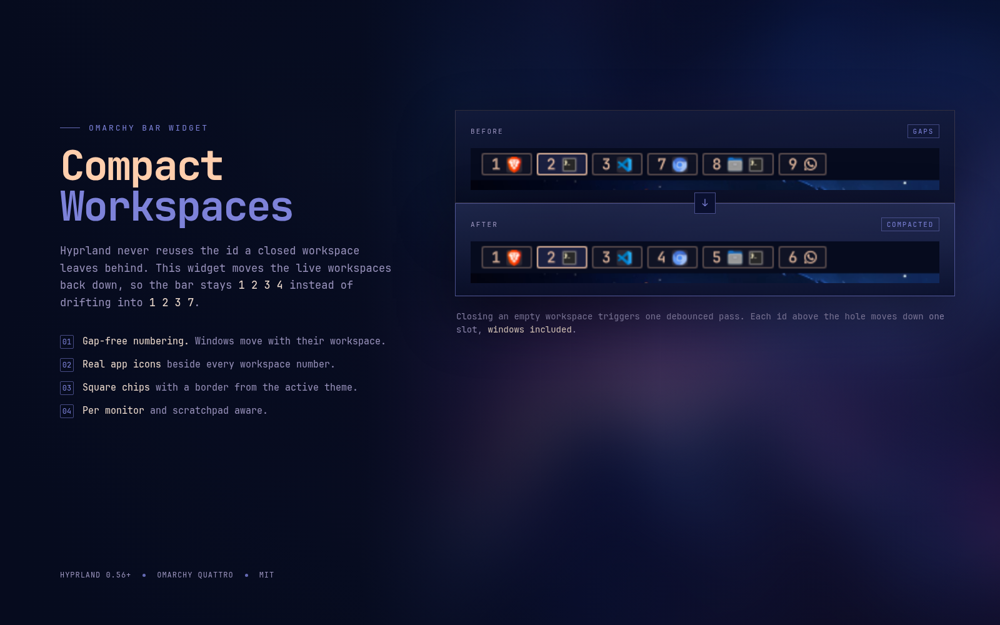

# Compact Workspaces

[](https://buymeacoffee.com/kaplanhalil)

Workspace pills for the Omarchy bar that show only the workspaces you use,
draw each window with its real application logo, and **close the holes Hyprland
leaves behind**.



Hyprland hands out numeric workspace ids and never reuses the id a destroyed
workspace leaves behind. After a while a bar that follows the ids reads
`1 2 3 7` even though only four workspaces exist. Compact Workspaces moves the
live workspaces back down so the sequence stays `1 2 3 4` — windows included.

The rest is a theme-native pill: square-ish corners, a border in the system
palette, the active workspace filled with the accent, and a real icon per open
window.

## Features

- **Gap-free workspace numbers.** A destroyed workspace triggers one debounced
  compaction pass that shifts the workspaces above it down.
- **Real app logos.** Icons come from the window's desktop entry and the system
  icon theme, with a Nerd Font glyph as the fallback.
- **Square, theme-bordered chips.** `pillRadius` defaults to 2 px and the
  1 px outline uses `Style`'s normal/hover/selected border tokens, so it follows
  the active Omarchy theme instead of hard-coded colours.
- **Only what is in use.** Empty workspaces stay off the bar until you step
  onto one.
- **Per monitor.** Each bar shows the workspaces on its own monitor and
  highlights its own active one.
- **Scratchpad pill.** Windows parked in `special:scratchpad` get their own
  chip instead of disappearing.
- **No root, no daemon, no network by default.** The only optional network use
  is `remoteIcons`, which is off unless you enable it.

## Install

```bash
omarchy plugin add https://github.com/KaplanHalil/omarchy-compact-workspaces.git --enable
```

The widget is placed on the left by default. Two workspace indicators side by
side is rarely useful, so disable the one you were using:

```bash
omarchy plugin disable omarchy.workspaces
# if you are coming from Advanced Workspaces:
omarchy plugin disable io.github.ehlxr.advanced-workspaces
```

If the widget is not placed automatically:

```bash
omarchy plugin enable io.github.kaplanhalil.compact-workspaces --section left --index 1
```

Remove it with:

```bash
omarchy plugin remove io.github.kaplanhalil.compact-workspaces
```

## How compaction works

Hyprland emits `destroyworkspace` when an empty workspace disappears. The
widget waits for the burst of workspace events to settle, reads the live list
with `hyprctl -j workspaces`, and asks Hyprland to move each gapped workspace
down with:

```text
hl.dsp.workspace.change_id({ workspace = "7", id = 4 })
```

The move is real: the workspace and every window on it keep running, but their
id changes. That is why the bar label and `SUPER + 4` agree after compaction.

Example:

```text
before:  1 2 3 7 8 9
after:   1 2 3 4 5 6
```

What is deliberately left alone:

- `special:*` workspaces and workspaces with a managed/named id (negative ids).
- Diagnostics on another monitor: gaps are closed inside each monitor's own
  sequence, and a move is skipped when the target id already belongs to another
  monitor. Sequential banks (`1-10` / `11-20`) compact independently;
  interleaved banks (odds / evens) stay put because their targets are occupied.
- The lowest id on a monitor is never renumbered, so a bank that starts at 11
  stays at 11.

The active workspace follows its own `change_id` move, so focus does not jump
to a different window. Compaction also runs once after the shell starts, which
cleans up ids left over from an earlier session.

> **This changes workspace ids.** If a workspace rule, a window rule, or an
> external script pins an application to a specific workspace number, that
> number now points at a different workspace. Set `compactIds` to `false` if
> you need Hyprland's original ids to stay stable. Named workspaces are never
> touched.

## Settings

Set these on the widget's entry in `~/.config/omarchy/shell.json`, or with
`omarchy bar set io.github.kaplanhalil.compact-workspaces <key> <value> --json`.
Bar widget settings take effect after a shell restart:

```bash
omarchy bar set io.github.kaplanhalil.compact-workspaces compactIds false --json
omarchy restart shell
```

| Key | Default | Meaning |
| --- | --- | --- |
| `compactIds` | `true` | Close gaps by moving live workspaces down. |
| `compactOnStart` | `true` | Run one compaction pass after the shell starts. |
| `compactDebounce` | `120` | Milliseconds to wait for workspace events to settle. |
| `pillRadius` | `2` | Pill and icon-tile corner radius in px. `0` is fully square. |
| `borderWidth` | `1` | Theme-coloured pill outline width in px. `0` removes it. |
| `perMonitor` | `true` | Show only workspaces belonging to this bar's monitor. |
| `showEmpty` | `false` | Keep every number from 1 to `maxWorkspaceId` on the bar. |
| `showIcons` | `true` | Draw an app icon per open window. |
| `maxIcons` | `0` | Cap icons per workspace, collapsing the rest to `+N`. `0` means no cap. |
| `iconSize` | 80% of the bar icon canvas | Logo size in px (minimum 6). |
| `iconGap` | `4` | Space in px between entries inside a pill. |
| `systemIcons` | `true` | Resolve each window's real logo from its desktop entry. |
| `remoteIcons` | `false` | Fetch missing brand logos over the network. |
| `remoteIconSource` | dashboard-icons via jsDelivr | URL template for logo fetches; `{slug}` is replaced. |
| `iconOverrides` | `{}` | Per-app icon overrides keyed by window class or `title:`. |
| `maxWorkspaceId` | `10` | Highest workspace id to consider. |
| `localWorkspaceNumbers` | `false` | Label each monitor's bank from 1. Display only. |
| `workspacesPerMonitor` | `10` | Bank size when local numbering is on. |
| `showScratchpad` | `true` | Show a pill while the scratchpad holds windows. |
| `scratchpadName` | `special:scratchpad` | Which special workspace to track. |
| `scratchpadLabel` | `S` | Text on the scratchpad pill. |

`showEmpty: true` and `compactIds: true` are intentionally independent: the
former pins every number on the bar, the latter keeps the live ids contiguous.
If you want Hyprland's original numbering back, turn compaction off.

## Requirements

- Omarchy Quattro (4.x) with the Quickshell shell.
- Hyprland 0.56 or newer for the Lua `hl.dsp.workspace.change_id` dispatcher.
- `hyprctl` (part of Hyprland) and `jq` for the compaction probe.
- No network access, root access, or background service is required.
  `remoteIcons` is the only opt-in network feature and is off by default.

## Development

The workspace planning rules are pure JavaScript and run under Node:

```bash
npm test
omarchy plugin validate .
/usr/lib/qt6/bin/qmllint -I "${OMARCHY_PATH:-/usr/share/omarchy}/shell" Workspaces.qml
omarchy restart shell
```

## Support

If Compact Workspaces is useful to you, you can buy me a coffee:

[Buy Me a Coffee](https://buymeacoffee.com/kaplanhalil)

## Credits

Forked from [Advanced Workspaces](https://github.com/ehlxr/advanced-workspaces)
by [@ehlxr](https://github.com/ehlxr) (MIT), which in turn forked
[Decent Workspaces](https://github.com/TheTrueFerret/omarchy-decent-workspaces)
by [@TheTrueFerret](https://github.com/TheTrueFerret) (MIT). The icon rule
table is adapted from the `saif.workspaces` plugin by Saif Omar (MIT).

## License

MIT. See [LICENSE](LICENSE).
